# Precooling Strategy Allows Exponentially Faster Heating #
Il progetto ha come obiettivo lo sviluppo della numerica e delle simulazioni in Python per analizzare l'articolo di Gal & Raz PRL 124, 060602 (2020) "Precooling Strategy Allows Exponentially Faster Heating". In particolare, si applica la teoria ad un modello di Ising AFM con campo esterno e lo si riscalda tramite due protocolli ("oven" e "precooling"). Si analizza se effettivamente si riesce ad ottenere un riscaldamento esponenzialmente più veloce seguendo un preliminare protocollo di raffreddamento.\
Il codice è diviso in moduli indipendenti per migliorare la leggibilità e la chiarezza. Le immagini e i grafici principali ottenuti sono riportati di seguito.

## Struttura dei codici 
- `src/`: implementazione del modello
- `main_eq.py`: studio dell'equilibrio di Ising AFM
- `main_eq_locus.py`: implementazione del diagramma di fase e del locus di equilibrio
- `main_traiettorie.py`: studio delle traiettorie fuori equilibrio
- `main_protocols.py`: sviluppo dei protocolli oven e precooling
- `main_lineare.py`: grafici lineari e semilog degli andamenti esponenziali
- `main_sizescaling.py`: analisi del size-scaling della transizione
- `figures/`: output delle simulazioni

## Analisi dell'equilibrio 
Studio dell'equilibrio del modello di Ising 2D AFM con campo su un reticolo LxL. Tutte le condizioni iniziali convergono allo stesso valore del punto della curva di equilibrio.\
A T_cold le configurazioni casuale e "all up" mostrano un delle curve sovrapponibili sia in M che in S. Il rilassamento è quindi dominato dalla distruzione dell'ordine staggered piuttosto che dalla crescita della magnetizzazione uniforme.

  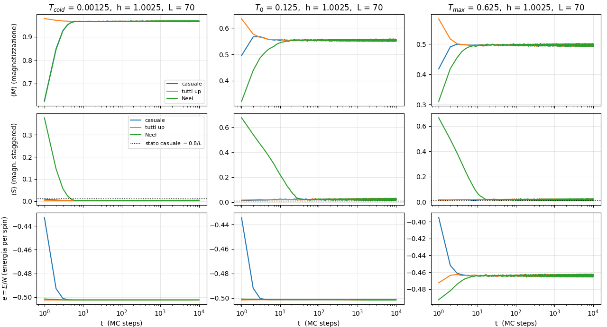
   
  <em>
  Figura 1: Rilassamento all'equilibrio
  </em>

Per stato casuale/disordinato circa 0.8/L si intende il valore tipico di S per uno stato in cui gli spin sono indipendenti e casuali. Si tratta si un pavimento di taglia finita per cui S non è mai esattamente zero. Per uno stato del genere X = Σ (−1)^(i+j) σ_ij ha media nulla e varianza = 1. Su N= L^2 siti, per il teorema del limite centrale, X è una gaussiana con media nulla e varianza L^2 (std dev = L) che può essere scritta come X = Lg, dove g è una gaussiana standard.\
S = |X|/N = L|g|/(L^2) = |g|/L da cui < |g| >/L = sqrt (2/pi) / L che è circa 0.8/L

  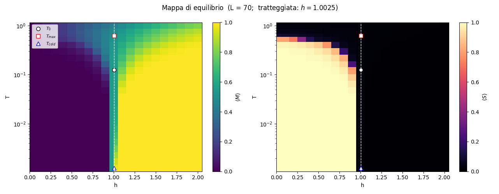
   
  <em>
  Figura 2: Mappa in funzione di h e T
  </em>

Dai grafici seguenti si nota che, per h < h_c = 1, il sistema ha una transizione di fase ordine-disordine. Sotto una temperatura critica T_c(h) è ordinato alla Néel, mentre sopra di essa il campo magnetizza gli spin aumentando M e distruggendo S. (La temperatura critica dell'antiferromagnete senza campo è 2.269·|J|/4 ≈ 0.57. Per h→1 T_c tende a zero, ecco perché per h=0.99 il salto è meno ampio)

  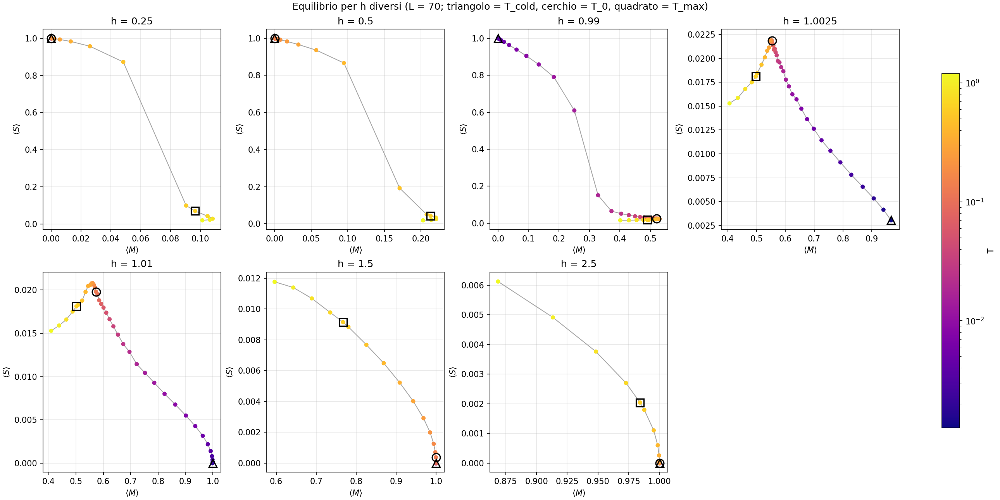
   
  <em>
  Figura 3: Curve di equilibrio nel piano < M > vs < S > per diversi valori del campo h
  </em>

Alla luce di quanto osservato per la transizione, si rimanda ad un approfondimento qualitativo sul size scaling all'appendice.

  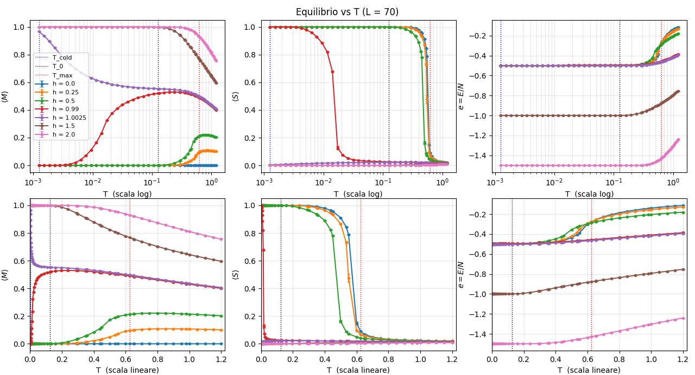
   
  <em>
  Figura 4: Evoluzione verso l'equilibrio di M, S ed e per diversi valori del campo. Osservando S si nota la transizione di fase ordine-disordine quando h < h_c = 1.
  </em>

  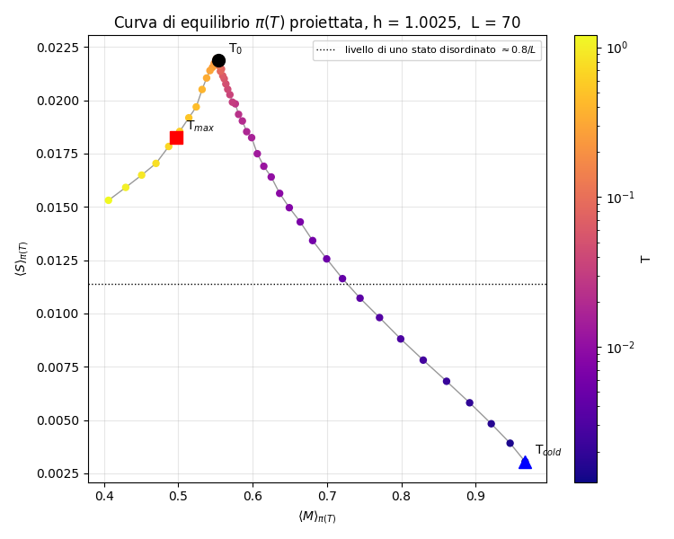
   
  <em>
  Figura 5: Curva di equilibrio
  </em>

## Traiettorie fuori equilibrio 

  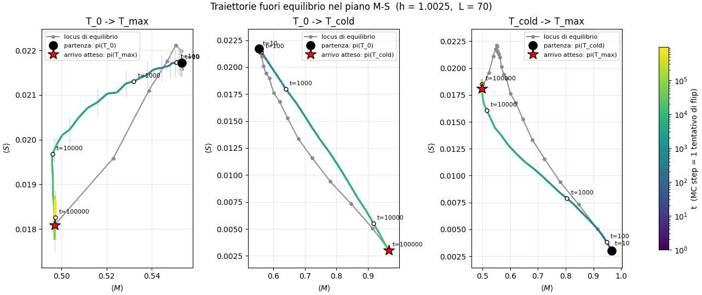
   
  <em>
  Figura 6: Traiettorie fuori equilibrio
  </em>

Le fluttuazioni in S avvicinandosi all'equilibrio sono dovute a due effetti principali:
1. il rumore rimane piuttosto "congelato" all'inizio della traiettoria a causa della correlazione con S(t=0), poi man mano che la memoria della configurazione iniziale viene persa le diverse realizzazioni si decorrelano e vengono introdotte delle nuove fluttuazioni;
2. il rumore costituisce circa il 6% sulla variazione di S lungo la traiettoria. Quando la curva si muove in fretta (all'inizio) è poco visibile, mentre appare quando la curva "si ferma" vicino all'equilibrio.
M non mostra le stesse oscillazioni perché il suo rumore è circa lo 0.2% della sua variazione.

  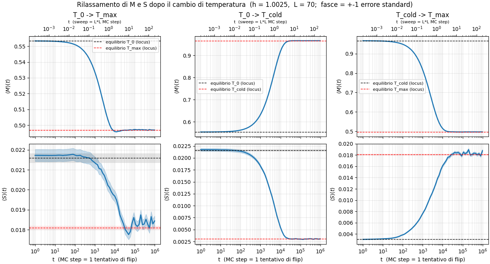
   
  <em>
  Figura 7: Evoluzione di M ed S durante le traiettorie fuori equilibrio 
  </em>

## Protocolli di riscaldamento
Allo scopo di cercare il tempo di precooling (tau) ottimale si effettua una scansione. Per ogni tau si misurano le medie di Delta_e e Delta_S in una finestra di tempo di riscaldamento \[2N, 6N]\ MC step dopo il cambio di temperatura a T_max. Viene scelto il tau che minimizza |<Delta_e>|.\
Come controllo di consistenza, dove |Delta_e| è minimo, |Delta_S| deve risultare molto piccolo e/o attraversare lo zero in un suo intorno.

  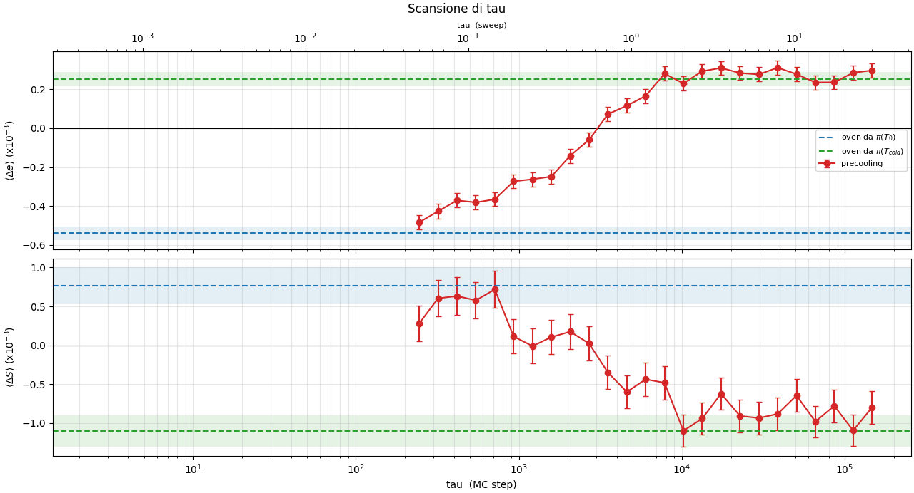
   
  <em>
  Figura 8: Scansione di tau (tempo di precooling)
  </em>

  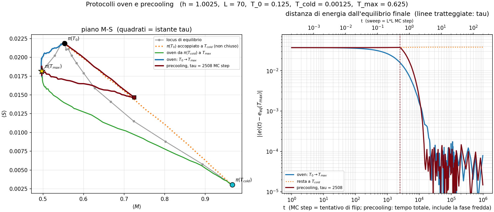
   
  <em>
  Figura 9: Traiettorie dei protocolli rispetto al locus e distanza di energia dall'equilibrio finale
  </em>

Le fluttuazioni all'equilibrio risultano più "dense" appena raggiunto e diventano più rade oltre 10^5 MC step a causa di come è stata costruita la griglia dei tempi. Essi sono costituiti dall'unione di punti logaritmici e lineari fino a 30 N (147000 MC step), poi soltanto logaritmici fino a 200 N (980000 MC step).

  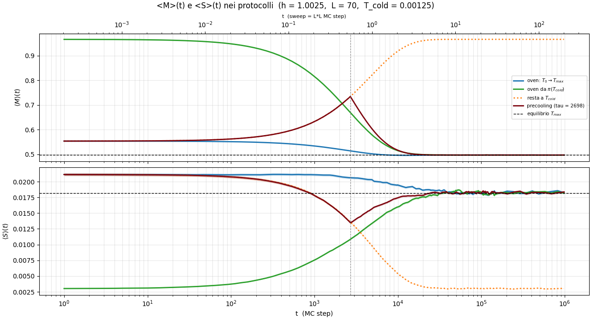
   
  <em>
  Figura 10: Evoluzione temporale di M ed S durante i protocolli
  </em>

  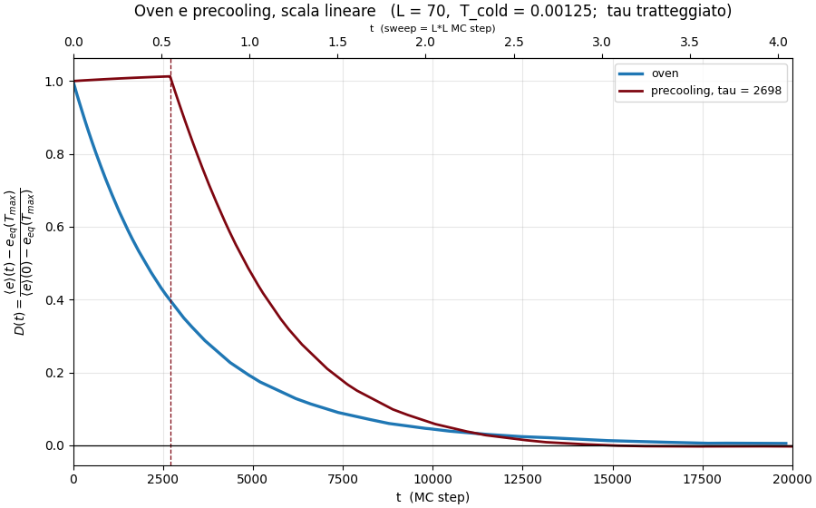
   
  <em>
  Figura 11: Distanza di energia dall'equilibrio normalizzata
  </em>

  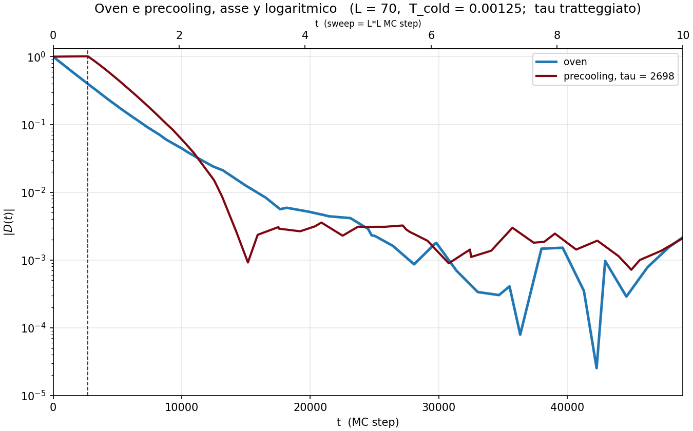
   
  <em>
  Figura 11: Distanza di energia dall'equilibrio normalizzata in scala semilog-y
  </em>

Nel grafico accanto alle traiettorie fuori equilibrio il rumore della distanza di energia sul plateau è dell'ordine 10^(-4). In questo grafico, invece, la distanza viene normalizzata usando < e >(0), ovvero l'energia per spin media sull'insieme preparato a T0, nonché la stima di e_eq(T0). Normalizzando qui lo stesso rumore risulta amplificato di circa un fattore 26. 

## Discrepanza dal paper
Nell'articolo si utilizza T_cold = 0.0125 (non 0.00125) e tau = 1850. Facendo un'analisi con quella temperatura di precooling, però, la scansione del tau ottimale restituisce un valore decisamente più alto e non si osserva il vantaggio del protocollo a due step. Lo stesso risultato infelice si ottiene forzando tau ad essere pari a 1850 come da paper.\
Il dubbio è che nell'articolo vi sia un errore nella descrizione della didascalia che introduce il valore di T_cold. In effetti, il punto di equilibrio del locus corrispondente a T_cold = 0.00125 (usato qui) ha lo stesso valore di < M > del punto di equilibrio a T_cold = 0.0125 (usato nell'articolo), sebbene la < S > sia differente. Rimane aperta la questione.\
Di seguito vengono riportati i grafici scorretti ottenuti usando la T di precooling come da paper.

  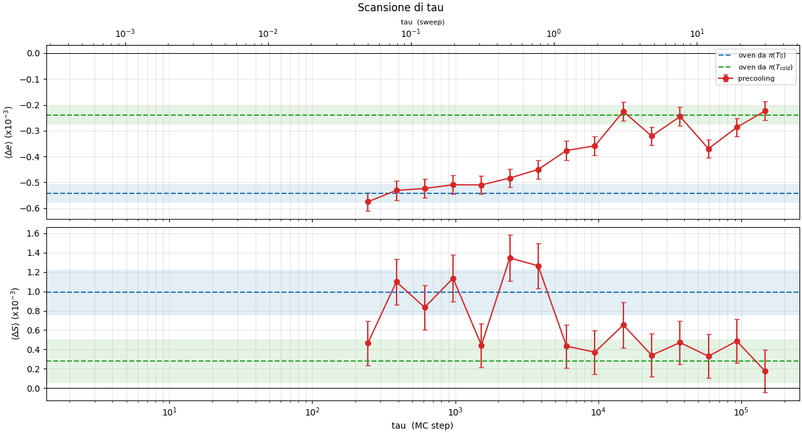
   
  <em>
  Figura 12: Scansione di tau scorretta (per T_cold = 0.0125) 
  </em>

  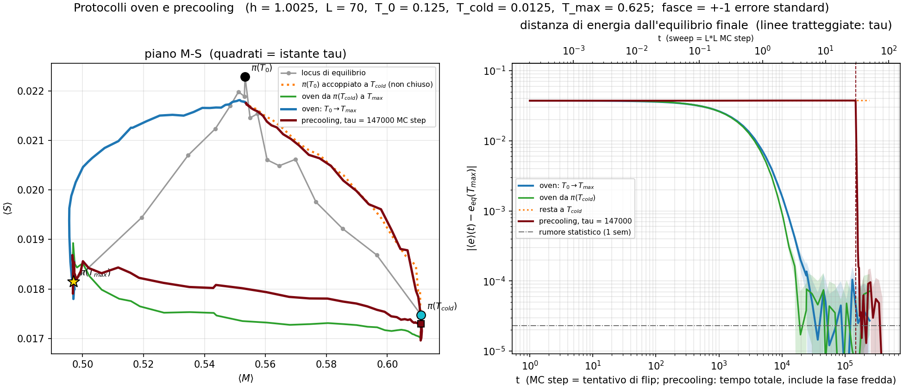
   
  <em>
  Figura 13: Traiettorie dei protocolli rispetto al locus e distanza di energia dall'equilibrio finale scorretti (per T_cold = 0.0125). Tau libero ottimizzato dalla scansione
  </em>

  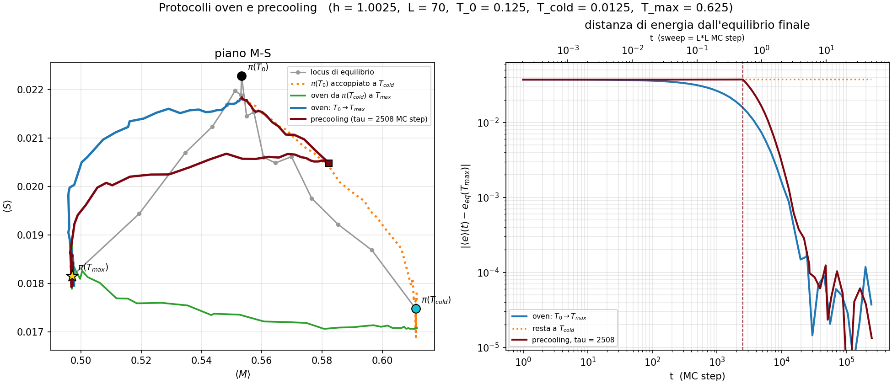
   
  <em>
  Figura 14: Traiettorie dei protocolli rispetto al locus e distanza di energia dall'equilibrio finale scorretti (per T_cold = 0.0125). Tau fissato dall'ottimizzazione a T_cold = 0.00125
  </em>

## Appendice: size scaling qualitativo della transizione
La transizione da anti-ferromagnete a paramagnete avviene "teoricamente" nel limite termodinamico. Infatti, fissando un valore del campo h e cambiando la dimensione L del sistema, si può notare un effetto di size-scaling qualitativo: il "salto" da S alti ad S bassi è più brusco all'aumentare della taglia del sistema.\
Dalla seguente immagine si nota che la temperatura critica sta intorno a 0.55

  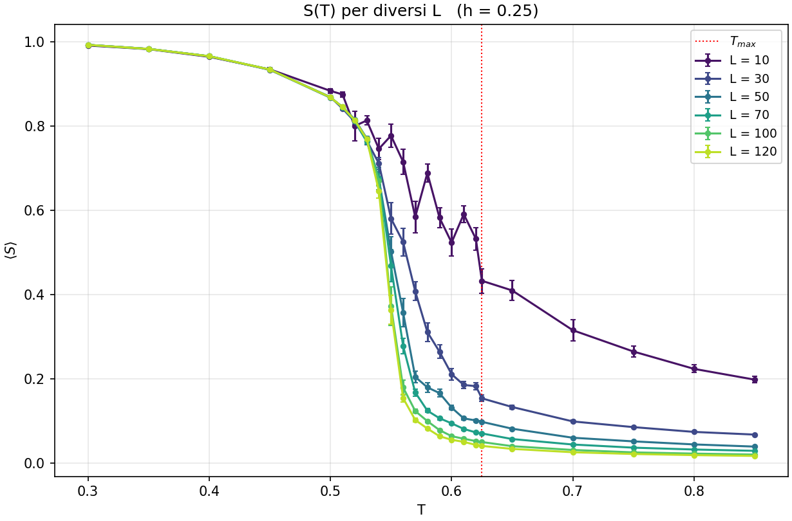
   
  <em>
  Figura 15: Size-scaling della transizione
  </em>

# Aggiunta originale: interazione a secondi vicini (nnn)
## Analisi dell'equilibrio

  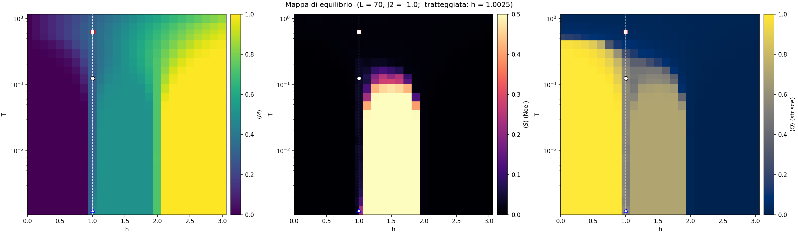
   
  <em>
  Figura 16: Size-scaling della transizione
  </em>

  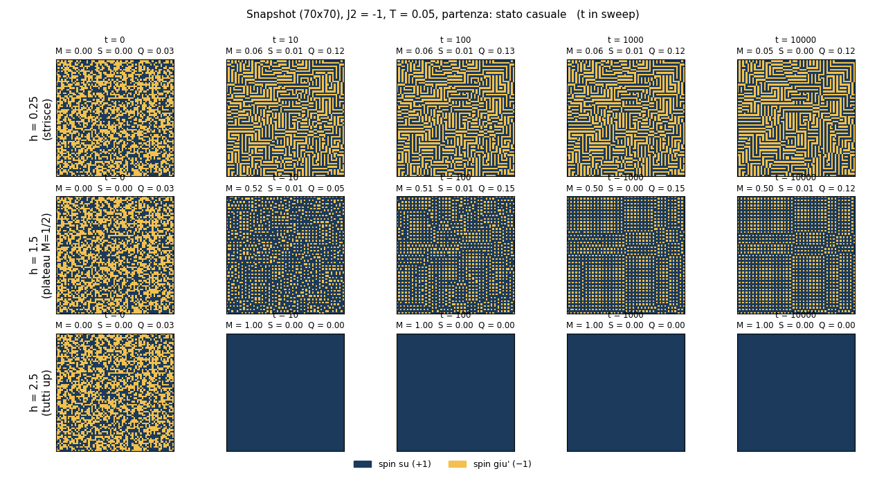
   
  <em>
  Figura 15: Size-scaling della transizione
  </em>

  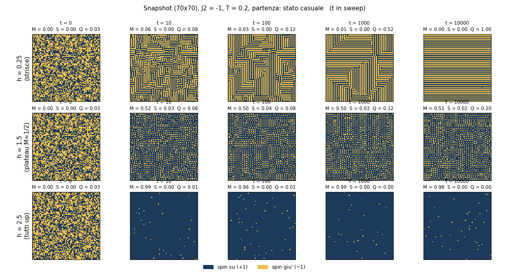
   
  <em>
  Figura 15: Size-scaling della transizione
  </em>

  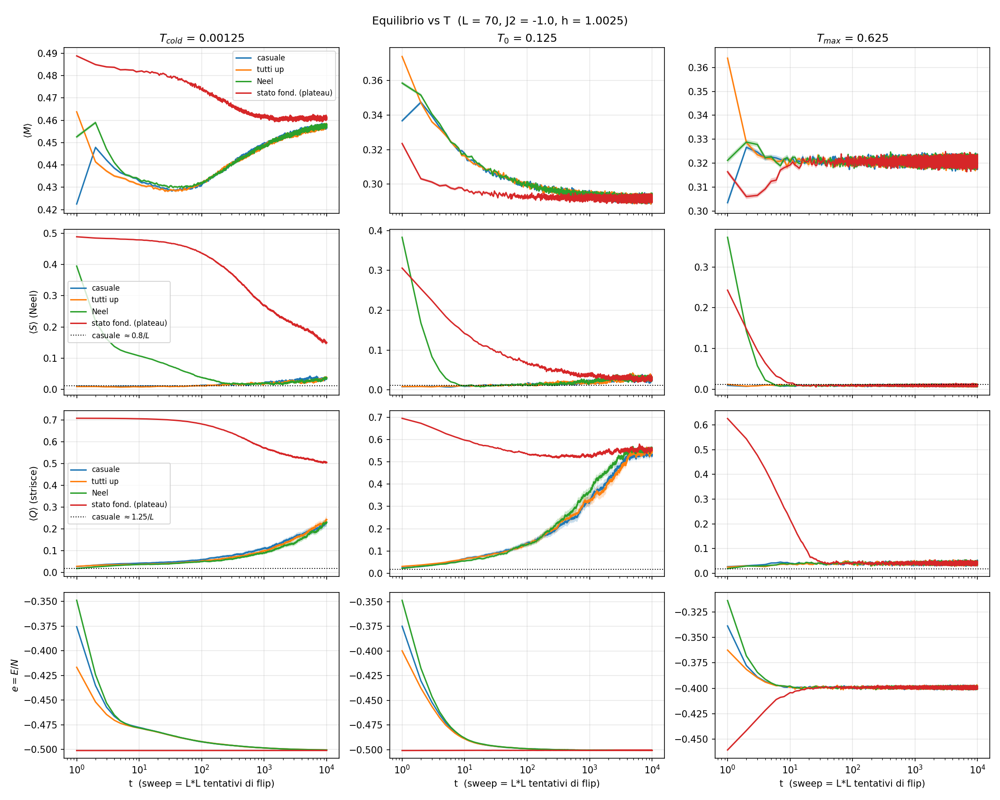
   
  <em>
  Figura 17: Size-scaling della transizione
  </em>

  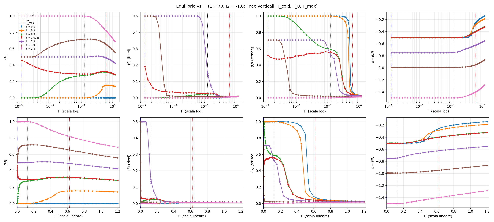
   
  <em>
  Figura 18: Size-scaling della transizione
  </em>

  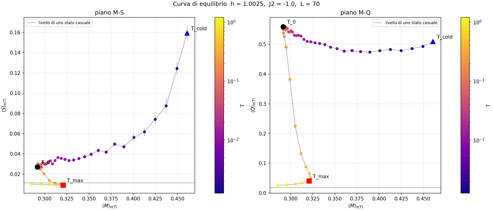
   
  <em>
  Figura 19: Size-scaling della transizione
  </em>

## Author 
Michele D'Urzo per l'esame di Sistemi Complessi Avanzati
