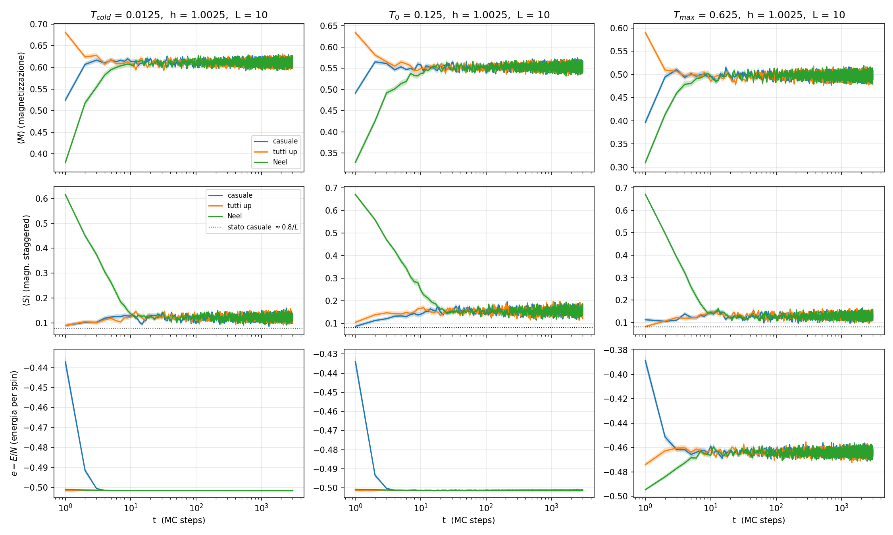
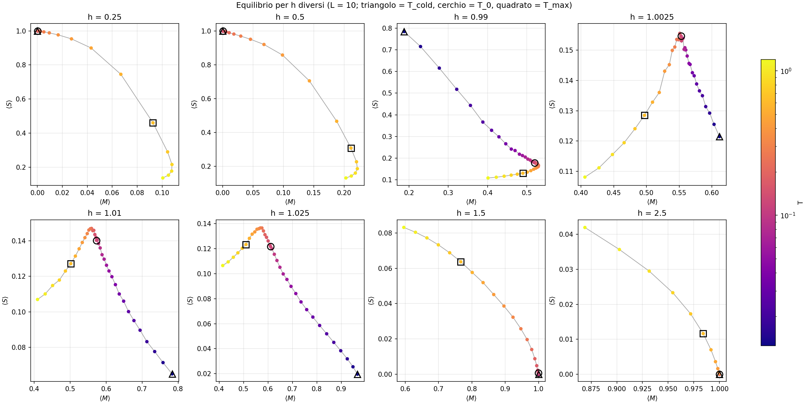
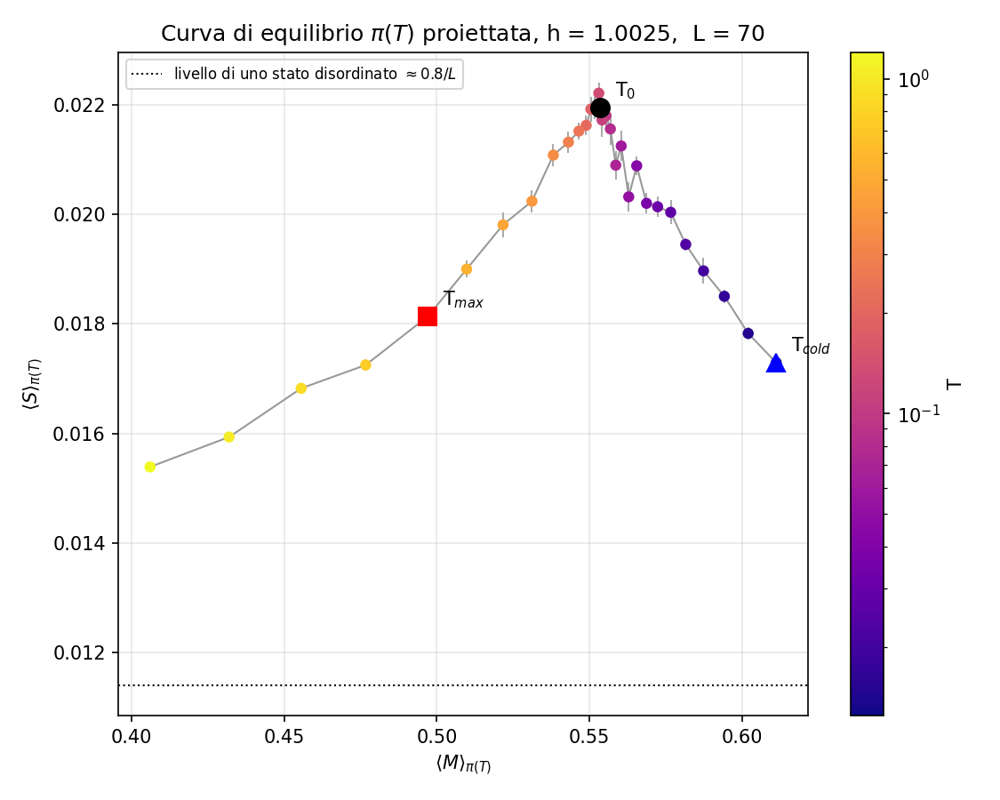
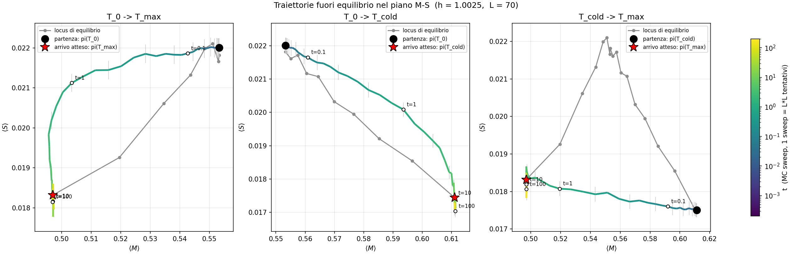

# Precooling Strategy Allows Exponentially Faster Heating #
Il progetto ha come obiettivo lo sviluppo della numerica e delle simulazioni in Python per analizzare l'articolo di Gal & Raz PRL 124, 060602 (2020) "Precooling Strategy Allows Exponentially Faster Heating". In particolare, si applica la teoria ad un modello di Ising AFM con campo esterno e lo si riscalda tramite due protocolli ("oven" e "precooling"). Si analizza se effettivamente si riesce ad ottenere un riscaldamento esponenzialmente più veloce seguendo un preliminare protocollo di raffreddamento.\
Il codice è diviso in moduli indipendenti per migliorare la leggibilità e la chiarezza. Le immagini e i grafici principali ottenuti sono riportati di seguito.

## Struttura dei codici 
- `src/`: implementazione del modello
- `main_eq.py`: studio dell'equilibrio di Ising AFM
- `main_eq_locus.py`: implementazione del diagramma di fase e del locus di equilibrio
- `main_traiettorie.py`: studio delle traiettorie fuori equilibrio
- `figures/`: output delle simulazioni

## Analisi dell'equilibrio 

  
   
  <em>
  Figura 1: Rilassamento all'equilibrio
  </em>

  
   
  <em>
  Figura 2: Curve di equilibrio nel piano `<M>` vs `<S>` per diversi valori del campo h
  </em>

  
   
  <em>
  Figura 3: Curva di equilibrio per L=70 e h=1.0025
  </em>

## Traiettorie fuori equilibrio 

  
   
  <em>
  Figura 4: Traiettorie fuori equilibrio
  </em>

## Author 
Michele D'Urzo per l'esame di Sistemi Complessi Avanzati
